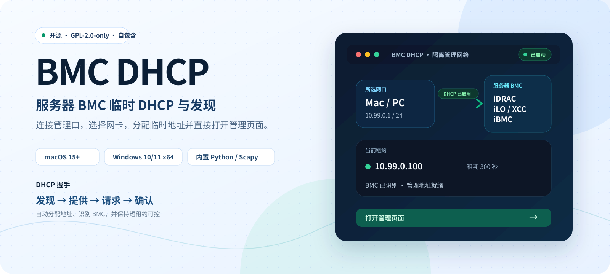
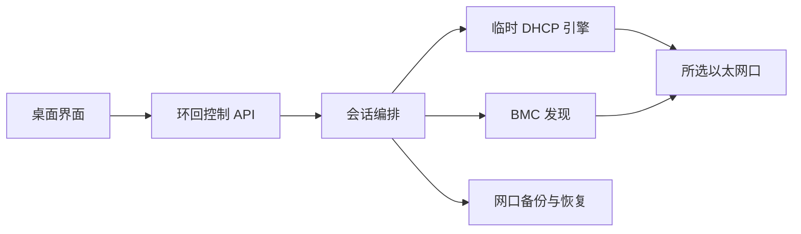

<p align="center">
  
</p>

<p align="center">
  <a href="https://github.com/wiswawa/bmc-dhcp/actions/workflows/ci.yml"></a>
  <a href="https://github.com/wiswawa/bmc-dhcp/releases"></a>
  
  
  
</p>

<p align="center">
  <strong>为服务器 BMC 分配临时 DHCP 地址，识别设备并直接打开管理页面。</strong><br>
  面向 iDRAC、iLO、XCC、iBMC 与其他 IPMI/BMC 控制器的首次接入工具。
</p>

<p align="center">
  <a href="https://github.com/wiswawa/bmc-dhcp/releases/tag/v1.9.0"><strong>下载 1.9.0 Beta</strong></a>
  ·
  <a href="docs/QUICKSTART.md">快速上手</a>
  ·
  <a href="docs/ARCHITECTURE.md">架构</a>
  ·
  <a href="docs/VALIDATION.md">验证记录</a>
  ·
  <a href="README.en.md">English</a>
</p>

> [!WARNING]
> 仅在 BMC 专用口直连或隔离管理网络中使用。不要在已有 DHCP 服务的共享办公网络启动第二个 DHCP 服务。

## 从一根网线到管理页面

电脑的一块网卡接到 BMC 管理口，在 BMC DHCP 中选择该网口，内置 DHCP 会完成 `DISCOVER → OFFER → REQUEST → ACK`。租约、识别证据和管理入口会集中显示在同一窗口。

```text
macOS / Windows 工作站             隔离管理链路                    服务器 BMC
10.99.0.1/24             <────────────────────────────────>       DHCP 客户端
                                DISCOVER → OFFER → REQUEST → ACK
```


<sub>截图来自 macOS 原生控制台的普通权限测试模式。自检通过不代表真实 BMC 已完成实机验证。</sub>

## 为什么使用 BMC DHCP

| 常见问题 | BMC DHCP 的处理方式 |
| --- | --- |
| 新 BMC 没有已知地址 | 在指定网口启动短生命周期 DHCP 服务 |
| 厂商和型号难以判断 | 综合服务、HTTP、TLS 证据并标出识别置信度 |
| 改网卡后担心无法恢复 | 修改前原子保存原配置，停止时恢复；失败保留恢复记录 |
| 管理地址埋在日志里 | 实时显示租约，并可直接打开识别出的管理页 |
| 桌面工具依赖复杂 | macOS 与 Windows 包均自带 Python 和 Scapy |

## 下载

请从 [GitHub Releases](https://github.com/wiswawa/bmc-dhcp/releases) 下载完整 ZIP；解压后保留 `_internal`、`Resources` 等运行时目录。

| 平台 | 包名 | 入口 |
| --- | --- | --- |
| macOS 15+ · Apple Silicon | `BMC-DHCP-1.9.0-macOS-arm64.zip` | `BMC DHCP.app` |
| macOS 15+ · Intel | `BMC-DHCP-1.9.0-macOS-x86_64.zip` | `BMC DHCP.app` |
| Windows 10/11 · x64 | `BMC-DHCP-1.9.0-Windows-x64.zip` | `BMC DHCP.exe` / `bmcd.exe` |

Windows 默认使用限定到所选网口的 UDP 传输。仅在需要二层抓包、被动侦听或跨网段 ARP 时安装 [Npcap](https://npcap.com/)；本项目不捆绑 Npcap。

## 快速上手

1. 将以太网卡接入 BMC 管理口或隔离管理交换机。
2. 下载并完整解压对应平台的 ZIP。
3. 打开应用，允许网络后台使用管理员权限/UAC。
4. 选择实际接线的网口；没有地址冲突时保持默认 `10.99.0.0/24`，启动服务。
5. 租约出现后打开管理链接。拔线前先停止服务。

默认地址为 `10.99.0.1/24`，地址池 `.100–.200`，租期 300 秒。更多操作见[快速上手](docs/QUICKSTART.md)和 [CLI 参考](docs/CLI_REFERENCE.zh-CN.md)。

## 核心能力

- 临时 DHCP、粘性 MAC-to-IP 分配和实时租约跟踪。
- 一键发现管理页面，并显示厂商与识别置信度证据。
- 针对静态 BMC 的被动发现、IPv6 邻居检测与限定网段 ARP 扫描。
- 原子网口备份与恢复；清理失败时保留可重试的恢复记录。
- 仅监听环回地址的本地 API，校验随机令牌、Host 和 Origin。
- 原生 macOS AppKit/WKWebView 窗口；Windows GUI 与 CLI 共用后台运行时。
- 实时日志、诊断信息和可独立运行的 `bmcd` 命令行入口。

<details>
<summary><strong>架构说明</strong></summary>



完整信任边界与生命周期见[架构文档](docs/ARCHITECTURE.md)。

</details>

## 验证状态

当前 `1.9.0` 为 **Beta**。协议、环回、打包和原生窗口自动检查已通过；真实 BMC 行为仍是明确的实机验证目标。

| 检查项 | 状态 |
| --- | --- |
| Python 3.11 / 3.13 / 3.15 CI 矩阵 | macOS 上通过 |
| macOS arm64 应用 | 已构建、签名并完成包内验证 |
| macOS Intel 应用 | 已构建、验证并检查架构 |
| Windows x64 GUI/CLI 包 | 已在 Windows 2025 runner 上实际运行 |
| 环回 DORA、会话生命周期与控制 API | 通过 |
| 真实 BMC DHCP 与提权网口恢复 | 尚未在参考硬件上验证 |

完整命令、CI 链接与限制见[验证记录](docs/VALIDATION.md)。

## 从源码运行

需要 Python 3.11+。

```bash
git clone https://github.com/wiswawa/bmc-dhcp.git
cd bmc-dhcp
python3 -m venv .venv
.venv/bin/python -m pip install -e '.[raw]'
.venv/bin/bmcd ifaces
.venv/bin/bmcd selftest
```

实际发地址使用 `./bmcd --iface <网卡名>`，启动器会请求 `sudo`。Windows 修改网口时，请在管理员终端中使用包内的 `bmcd.exe`。

## 安全模型

- 桌面界面保持普通权限，只有网络后台请求管理员权限/UAC。
- 首次修改前先持久化原网口状态；备份写入失败时立即中止。
- 恢复失败时保留原始记录并允许重试，避免静默覆盖。
- 本地控制台仅监听环回地址，并拒绝不可信的 Host/Origin 组合。
- 项目不提供 NAT、互联网共享、DNS 转发、PXE 或 TFTP。

macOS 应用使用 ad-hoc 签名且未公证；Windows EXE 未代码签名。在敏感环境部署前请阅读[安全政策](SECURITY.md)和验证记录。

## 开发与贡献

- [参与贡献](CONTRIBUTING.md)：开发环境、测试要求和硬件报告格式。
- [发布指南](docs/RELEASING.md)：桌面构建、对应源码、许可证与签名。
- [安全政策](SECURITY.md)：私有漏洞报告。
- [社区规范](CODE_OF_CONDUCT.md)：项目交流与协作边界。
- [Discussions](https://github.com/wiswawa/bmc-dhcp/discussions)：问题、想法与兼容性报告。

GitHub CI 覆盖静态检查、前端冒烟、wheel 安装和 macOS Python 矩阵。发布工作流会先构建并验证 Apple Silicon、Intel 与 Windows x64 候选包，再由维护者公开。

## 许可证

项目采用 [GPL-2.0-only](LICENSE)。Scapy 同为 GPL-2.0-only；二进制分发包携带许可证、第三方声明以及项目和 Scapy 对应源码，见[第三方声明](THIRD_PARTY_NOTICES.md)。
