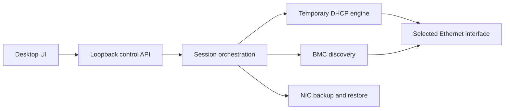

<p align="center">
  
</p>

<p align="center">
  <a href="https://github.com/wiswawa/bmc-dhcp/actions/workflows/ci.yml"></a>
  <a href="https://github.com/wiswawa/bmc-dhcp/releases"></a>
  
  
  
</p>

<p align="center">
  <strong>Give a server BMC a temporary DHCP address, identify it, and open its management page.</strong><br>
  A focused desktop tool for first contact with iDRAC, iLO, XCC, iBMC and other IPMI/BMC controllers.
</p>

<p align="center">
  <a href="https://github.com/wiswawa/bmc-dhcp/releases/tag/v1.9.0"><strong>Download 1.9.0 Beta</strong></a>
  ·
  <a href="docs/QUICKSTART.md">Quick start</a>
  ·
  <a href="docs/ARCHITECTURE.md">Architecture</a>
  ·
  <a href="docs/VALIDATION.md">Verification</a>
  ·
  <a href="README.zh-CN.md">简体中文</a>
</p>

> [!WARNING]
> Use BMC DHCP on a directly connected BMC port or an isolated management network. Do not start a second DHCP server on a shared office network.

## From cable to browser

Connect one Ethernet adapter to the BMC management port, select it in BMC DHCP, and let the built-in DHCP server complete `DISCOVER → OFFER → REQUEST → ACK`. Leases, host evidence and management URLs appear in one place.

```text
macOS / Windows workstation          isolated management link          server BMC
10.99.0.1/24                <────────────────────────────────>        DHCP client
                                 DISCOVER → OFFER → REQUEST → ACK
```


<sub>Native macOS console shown in nonprivileged test mode. A successful self-test does not mean a physical BMC has been validated.</sub>

## Why BMC DHCP

| Problem | What BMC DHCP adds |
| --- | --- |
| A new BMC has no known address | Starts a short-lived DHCP service on one selected interface |
| Vendor identification is guesswork | Combines service, HTTP and TLS evidence with confidence reporting |
| Network recovery is risky | Saves the original NIC configuration atomically before changes and restores it on stop |
| The management URL is buried in logs | Shows live leases and opens the detected management page directly |
| Desktop tools need extra runtimes | macOS and Windows packages bundle Python and Scapy |

## Download

Use the complete ZIP from [GitHub Releases](https://github.com/wiswawa/bmc-dhcp/releases); keep runtime directories such as `_internal` and `Resources` next to the executable.

| Platform | Package | Entry point |
| --- | --- | --- |
| macOS 15+ · Apple Silicon | `BMC-DHCP-1.9.0-macOS-arm64.zip` | `BMC DHCP.app` |
| macOS 15+ · Intel | `BMC-DHCP-1.9.0-macOS-x86_64.zip` | `BMC DHCP.app` |
| Windows 10/11 · x64 | `BMC-DHCP-1.9.0-Windows-x64.zip` | `BMC DHCP.exe` / `bmcd.exe` |

Windows packages use a bounded UDP transport by default. Install [Npcap](https://npcap.com/) only when raw Ethernet capture or passive discovery is required. Npcap is not bundled.

## Quick start

1. Connect the Ethernet adapter to the BMC management port or an isolated management switch.
2. Download and fully extract the package for your platform.
3. Open the app and approve the administrator/UAC prompt for the networking backend.
4. Select the connected interface, leave the default `10.99.0.0/24` pool unless it conflicts, and start the service.
5. Open the management link beside the lease. Stop the service before unplugging the cable.

Defaults: `10.99.0.1/24`, pool `.100–.200`, 300-second leases. See [Quick start](docs/QUICKSTART.md) and the [CLI reference](docs/CLI_REFERENCE.zh-CN.md).

## Core capabilities

- Temporary DHCP with sticky MAC-to-IP allocation and live lease tracking.
- One-click management-page discovery with vendor and confidence evidence.
- Passive discovery, IPv6-neighbor inspection and bounded ARP scans for statically addressed BMCs.
- Atomic NIC backup and restore with persistent recovery records when cleanup fails.
- Loopback-only local API with random session tokens plus Host and Origin validation.
- Native macOS AppKit/WKWebView shell; Windows GUI and CLI share the same backend runtime.
- Diagnostics, logs and a standalone `bmcd` CLI for scripted or headless workflows.

<details>
<summary><strong>Architecture</strong></summary>



See [Architecture](docs/ARCHITECTURE.md) for the trust boundaries and lifecycle model.

</details>

## Verification

The current `1.9.0` release is a **Beta**. Automated protocol, loopback, packaging and native-window checks pass; physical BMC behavior remains an explicit hardware-verification target.

| Check | Status |
| --- | --- |
| Python 3.11 / 3.13 / 3.15 CI matrix | Passing on macOS |
| macOS arm64 app | Built, signed and package-verified |
| macOS Intel app | Built, package-verified and architecture-checked |
| Windows x64 GUI/CLI package | Executed on a Windows 2025 runner |
| Loopback DORA, session lifecycle and control API | Passing |
| Physical BMC DHCP and privileged NIC recovery | Not yet validated on reference hardware |

See [Verification](docs/VALIDATION.md) for exact commands, CI links and limits.

## Run from source

Python 3.11+ is required.

```bash
git clone https://github.com/wiswawa/bmc-dhcp.git
cd bmc-dhcp
python3 -m venv .venv
.venv/bin/python -m pip install -e '.[raw]'
.venv/bin/bmcd ifaces
.venv/bin/bmcd selftest
```

For live DHCP, use `./bmcd --iface <interface>` with the actual adapter name. The launcher requests `sudo`. On Windows, use the packaged `bmcd.exe` from an elevated terminal for interface changes.

## Safety model

- The desktop UI is unprivileged; only the networking backend requests administrator/UAC approval.
- The original interface state is persisted before the first change. If that backup cannot be written, the operation stops.
- Failed recovery keeps the original record and can be retried instead of silently discarding it.
- The local console listens only on loopback and rejects untrusted Host/Origin combinations.
- The project does not provide NAT, Internet Sharing, DNS forwarding, PXE or TFTP.

The macOS app uses an ad-hoc signature and is not notarized. Windows executables are unsigned. Review the [security policy](SECURITY.md) and verification notes before deploying in a sensitive environment.

## Build and contribute

- [Contributing](CONTRIBUTING.md) — development setup, testing expectations and hardware-report format.
- [Release guide](docs/RELEASING.md) — desktop builds, corresponding source, licenses and signing.
- [Security policy](SECURITY.md) — private vulnerability reporting.
- [Code of conduct](CODE_OF_CONDUCT.md) — community expectations.
- [Discussions](https://github.com/wiswawa/bmc-dhcp/discussions) — questions, ideas and compatibility reports.

Hosted CI runs lint, UI smoke checks, wheel installation and the macOS Python matrix. The release workflow builds Apple Silicon, Intel and Windows x64 candidates before a maintainer publishes them.

## License

[GPL-2.0-only](LICENSE). Scapy is also GPL-2.0-only. Binary distributions include license texts, third-party notices and corresponding project/Scapy source. See [third-party notices](THIRD_PARTY_NOTICES.md).
